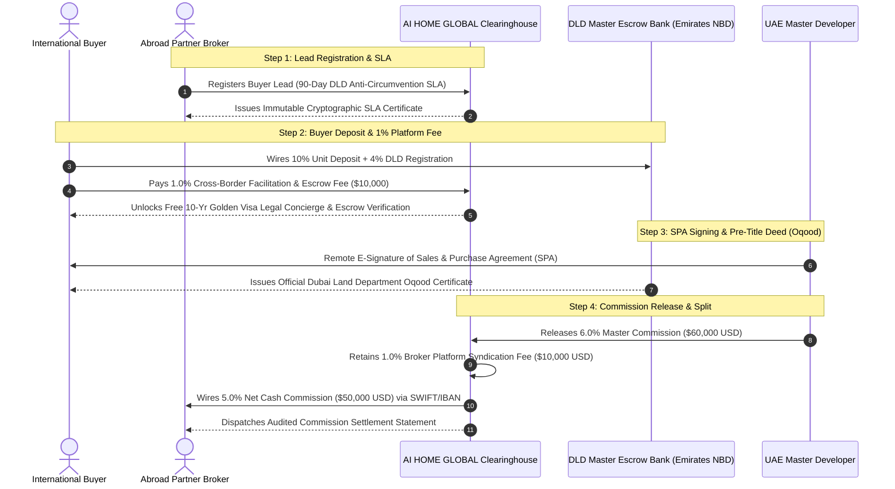

# AI HOME GLOBAL | Dual-Sided 1% + 1% Commission & Platform Escrow Protocol
> **Standard Operating Procedure (SOP), Legal Architecture & Mathematical Formulation for Cross-Border Real Estate Transactions**

---

## 📌 Executive Summary

To provide complete institutional trust, 90-day anti-circumvention protection, direct-to-DLD escrow routing, and 10-Year Golden Visa legal administration, **AI HOME GLOBAL** operates through a **UAE RERA-Licensed Master Brokerage (ORN Holder)** on a **Tri-Party Dual-Sided 1% + 1% Settlement Model**:

1. **Party A (The International Buyer — Optional Legal & Visa Retainer)**: Pays a **1.0% Cross-Border Legal, Golden Visa & DTA Tax-Clearance Retainer** (or receives an equivalent 1.0% institutional developer rebate offset on master-allocated units). **100% of property purchase installments wire directly from the buyer to the Developer's DLD-Regulated Escrow Bank Account**—the portal never holds property principal.
2. **Party B (The Overseas Broker — Master ORN Platform Retention)**: Contributes a **1.0% Platform Syndication & SLA Lead Protection Fee** retained at source by the UAE Master Entity upon developer commission disbursement. Net commission ($R_{\text{gross}} - 1.0\%$) is wired via SWIFT/IBAN at **0% UAE VAT (Export of Services)** once the developer milestone clears (**20% buyer equity + 4% DLD Oqood registration**).

**Total Platform Yield per Transaction: 2.0% of Property Sales Value.**

---

## 📐 Mathematical Formulation

Let:
- $V$ = Total Registered Property Purchase Price (DLD Sales Value)
- $R_{\text{gross}}$ = Gross Developer Commission Rate (typically 5.0% to 7.0%)
- $F_{\text{buyer}}$ = Buyer Platform Facilitation Fee (1.0%)
- $F_{\text{broker}}$ = Overseas Broker Platform Fee (1.0%)
- $P_{\text{net}}$ = Net Commission Wired to the Abroad Broker
- $R_{\text{portal}}$ = Total Gross Revenue Generated by AI HOME GLOBAL

### Formula Equations:

$$F_{\text{buyer}} = V \times 0.010$$

$$C_{\text{gross}} = V \times R_{\text{gross}}$$

$$F_{\text{broker}} = V \times 0.010$$

$$P_{\text{net}} = C_{\text{gross}} - F_{\text{broker}} = V \times (R_{\text{gross}} - 0.010)$$

$$R_{\text{portal}} = F_{\text{buyer}} + F_{\text{broker}} = (V \times 0.010) + (V \times 0.010) = V \times 0.020$$

---

## 💡 Practical Numerical Example: $1,000,000 USD (€920,000 / AED 3,672,500) Deal

Suppose an overseas broker in London or Frankfurt closes a luxury unit valued at **$1,000,000 USD** with a **6.0% Developer Gross Commission**:

| Financial Component | Percentage | Amount in USD | Payor / Beneficiary | Settlement Timing |
| :--- | :--- | :--- | :--- | :--- |
| **Property Purchase Price ($V$)** | 100.0% | **$1,000,000 USD** | Buyer ➔ Developer Escrow | According to milestone payment plan |
| **Buyer Legal & Visa Retainer ($F_{\text{buyer}}$)** | **1.0%** | **$10,000 USD** | Buyer ➔ UAE Legal Retainer | Optional conveyancing / Golden Visa retainer (or 1% developer rebate offset) |
| **Gross Developer Commission ($C_{\text{gross}}$)** | 6.0% | **$60,000 USD** | Master Developer ➔ UAE ORN Entity | Upon 20% equity + 4% DLD Oqood clearance |
| **Abroad Broker Platform Fee ($F_{\text{broker}}$)** | **1.0%** | **$10,000 USD** | Broker ➔ UAE ORN Entity | Retained at source upon commission receipt |
| **Abroad Broker Net Cash Payout ($P_{\text{net}}$)** | **5.0% Net** | **$50,000 USD** | UAE ORN Entity ➔ Abroad Broker | Wired via SWIFT/IBAN (0% UAE VAT Export of Services) |
| **Total Portal Monetization ($R_{\text{portal}}$)** | **2.0% Total** | **$20,000 USD** | Retained by AI HOME GLOBAL | Fully settled |

---

## 🔄 End-to-End Workflow & Settlement Triggers

---

## ⚖️ Legal Justification & Value Proposition for Both Parties

### Why the Foreign Buyer Gladly Pays the 1%:
1. **Free 10-Year UAE Golden Visa Administration**: Full legal documentation, medical VIP fast-track, and family sponsorship handling included at zero extra legal fees (ordinarily costs $5,000–$10,000 via private law firms).
2. **Independent Escrow Vetting & Audit**: Verified protection ensuring all funds are strictly deposited into official Central Bank of the UAE / DLD trust accounts.
3. **Double Taxation Treaty (DTA) Tax Clearance Dossier**: Official legal certification for buyer's home tax authorities (e.g. German Finanzamt, UK HMRC, French DGFiP) confirming 0% tax liability in the UAE.
4. **Bilingual Concierge Desk**: Full remote e-notarization without requiring flights to Dubai.

### Why the Overseas Broker Gladly Pays the 1%:
1. **90-Day Legal Anti-Circumvention SLA**: Developers are contractually bound under UAE Federal Civil Law not to bypass the overseas broker.
2. **Access to Top Pre-Allocated Tier-1 Commissions**: Standard international referral rates without a portal are usually 1.5%–2.5%. Through AI HOME GLOBAL, the gross rate is 5%–7%, leaving the broker with **4.0% to 6.0% net** even after the 1% platform fee.
3. **No UAE Licensing Overhead**: Brokers do not need to register a UAE LLC, hire a local sponsor, or obtain RERA broker licenses (saves $25,000+/yr in compliance costs).
4. **Turnkey Unbranded Marketing & Closing Directors**: 1-click white-label PDF decks, 4K FPV drone suite, and senior Dubai closing directors who co-pitch and close deals on the broker's behalf under their own agency banner.

---

## 📄 Legal Wording for Contractual Insertion

### Clause 4.1: Buyer Platform Facilitation Fee
> *"The Purchaser acknowledges that an International Transaction & Escrow Facilitation Fee equivalent to one percent (1.0%) of the total Property Purchase Price shall be payable to AI HOME GLOBAL upon execution of the Reservation Agreement. This fee covers cross-border multi-currency routing, legal escrow verification, independent contract audit, and complimentary processing of the UAE 10-Year Golden Visa application for the Purchaser and immediate qualifying dependents."*

### Clause 5.2: Broker Platform Syndication Retainer
> *"The Accredited International Broker agrees that AI HOME GLOBAL shall retain a platform syndication and lead protection fee of one percent (1.0%) of the Property Purchase Price from the gross developer commission. The remaining balance (representing the net commission of between 4.0% and 6.0% of the Property Purchase Price) shall be remitted to the Broker's designated international bank account within fourteen (14) business days of official SPA registration with the Dubai Land Department."*
